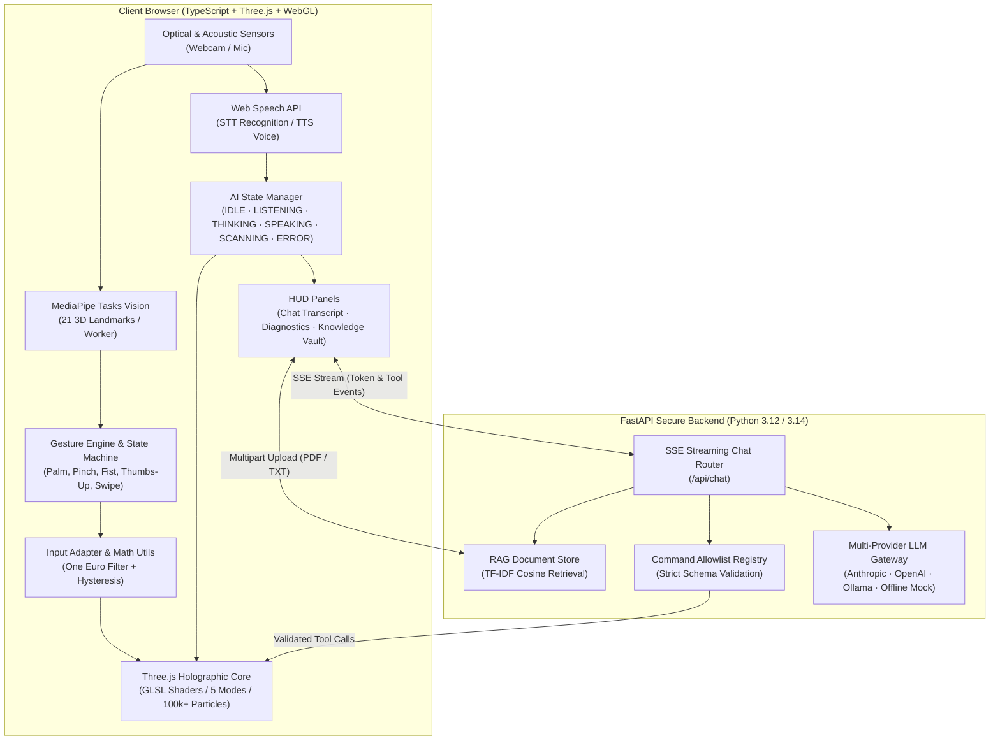

# ULTIMAITRON AI 2.0 — Holographic AI Companion Interface

<p align="center">
  <strong>Gesture-Controlled Holographic Neural Core · Real-time Computer Vision · Multi-Provider Streaming LLM · Voice STT/TTS · Document Knowledge Vault</strong>
</p>

---

## 1. System Architecture

ULTIMAITRON AI 2.0 transforms procedural 3D real-time graphics into an interactive, full-stack AI holographic companion. The system bridges local browser computer vision, spatial mathematics, WebGL GLSL shaders, Web Speech audio, and a high-performance Python FastAPI backend orchestrating LLM streaming, safe function calling, and RAG document retrieval.



---

## 2. Core Capabilities

### 🧠 Real Multi-Provider AI Brain
- **Streaming Server-Sent Events (SSE)**: Streams tokens in real time directly to the holographic transcript with measurable Time to First Token (TTFT) and total response latency.
- **Provider Adapters**:
  - **Anthropic Claude** (`claude-3-5-sonnet-20241022`)
  - **OpenAI** (`gpt-4o-mini`, `gpt-4o`)
  - **Ollama** (`llama3.2`, `mistral`, local models)
  - **Intelligent Offline Mock Assistant**: Zero-setup, runs out of the box with zero credentials, answering technical queries and executing system tools.
- **Strict Credential Isolation**: All API keys remain strictly on the backend; never exposed to the client browser.

### 🔮 Holographic Shader Core & AI State Synchronization
The neural orb synchronizes dynamically across 6 operational states, altering GLSL uniform parameters:
- **`IDLE`**: Baseline harmonic breathing, cyan spectral glow ($\lambda \approx 490\text{nm}$), nominal synapse pulse frequency.
- **`LISTENING`**: Elevated energy baseline, acoustic sensitivity halo, pulse expansion.
- **`THINKING`**: Rapid synaptic wavefront acceleration, chromatic turbulence, amber undertones.
- **`SPEAKING`**: Multi-harmonic voice amplitude modulation driving surface ripples and core luminosity.
- **`SCANNING`**: Directional radar sweep arc, high-frequency coordinate targeting.
- **`ERROR`**: Crimson warning wash, post-processing vignette glitch, rapid distress flutter.

### 🛡️ Central Command Registry & Safe Function Calling
AI agents can manipulate the 3D hologram **only** through explicitly validated commands registered in the backend allowlist:
| Permitted Action | Parameters | Description |
|---|---|---|
| `change_orb_mode` | `mode: NEURAL \| REACTOR \| DATA \| ENERGY \| SCANNER` | Smoothly morphs shader profiles and topology. |
| `fire_pulse` | `intensity: 0.1 .. 3.0` | Dispatches spherical shockwave through vertex network. |
| `trigger_burst` | `warm: 0.0 .. 1.0` | Ejects high-velocity particle plume and expands core. |
| `set_orb_scale` | `scale: 0.6 .. 1.8` | Modulates hologram physical footprint. |
| `set_warmth` | `warmth: 0.0 .. 1.0` | Shifts color temperature from cyan to golden amber. |
| `open_panel` | `panel: chat \| diagnostics \| knowledge` | Opens or toggles HUD telemetry interfaces. |
| `reset_system` | `none` | Re-centers camera rig, resets scale, and restores NEURAL mode. |

*Arbitrary code execution generated by an LLM is categorically rejected by the backend Pydantic validation schema.*

### 🎙️ Speech Interaction & Phonetic Cadence
- **Speech-to-Text (STT)**: Hands-free voice queries using the browser Web Speech API with interim transcripts and error detection.
- **Text-to-Speech (TTS)**: High-fidelity natural voice output with automatic markdown stripping.
- **Phonetic Amplitude Simulation**: Voice output calculates an authentic multi-harmonic amplitude envelope:
  $$A(t) = 0.5 + 0.3 \sin(0.7 \omega t) + 0.15 \sin(2.1 \omega t) + 0.1 \sin(4.3 \omega t)$$
  modulating the orb surface ripple without requiring insecure audio loopback nodes.
- **User Privacy & Consent**: Microphone access is user-initiated; audio frames never leave the client.

### 🖐️ Computer Vision & Gesture State Machine
- **MediaPipe Tasks-Vision**: 21 3D hand landmarks processed in a background Web Worker (60 FPS on GPU delegate, fallback to WASM).
- **Temporal Stability**: One Euro filtering ($f_c = 1.2\text{Hz}, \beta = 0.007$) eliminates jitter; state debouncing ($120\text{ms}$) prevents edge flapping.
- **Recognized Gestures**:
  - `OPEN_PALM`: Energizes the neural core and fires concentric pulses.
  - `PINCH`: Target acquisition and interactive rotation/drag.
  - `FIST`: Contracts particle radius and arms high-energy burst on release.
  - `THUMBS_UP`: Action confirmation and affirmative companion response.
  - `SWIPE`: Cyclical mode switching with spatial direction gating.
- **Mouse / Touch Fallback**: Automatic steering, pinch-drag, and wheel zoom when optical sensors are offline.

### 📚 Document Knowledge Vault (RAG)
- **Multi-Format Ingestion**: Drag-and-drop or upload TXT, PDF, MD, or JSON documents up to 10 MB.
- **Recursive Chunking**: Overlapping 400-character windows preserve semantic continuity.
- **Lexical Cosine Retrieval**: TF-IDF vector ranking extracts relevant passages into the prompt with source citations (`[filename.pdf #Chunk 2]`).
- **Grounding Integrity**: System explicitly flags when uploaded documents lack sufficient evidence to answer.

### 📊 Real-Time Diagnostics & Performance Dashboard
Displays genuine runtime measurements without fabricated telemetry:
- Render FPS & Frame Time ($\text{ms}$)
- Optical Gesture Latency ($\text{ms}$) & Inference Frequency ($\text{Hz}$)
- AI Time to First Token (TTFT $\text{ms}$) & Total Response Time ($\text{ms}$)
- Optical / Acoustic Sensor States
- Backend API Connectivity & Provider Tier
- Active Particles ($24,000$ to $120,000+$) & GPU Draw Calls

---

## 3. Shaders and Mathematics

### 1. Icosahedral Geodesic Subdivision
Particles and synapses originate from a recursively subdivided icosahedron, projected onto a unit sphere $S^2$:
$$v_n = \frac{v_a + v_b}{\|v_a + v_b\|} \cdot R_0$$
Yielding uniform spatial distribution without polar pinching.

### 2. Simplex Noise Radial Displacement
Orb vertices are perturbed along surface normals in the vertex shader:
$$P'(v, t) = P(v) + \vec{n} \cdot \left[ A_1 \mathcal{N}(P \cdot f_1 + \vec{\omega} t) + A_2 \mathcal{N}(P \cdot f_2 - 1.6 \vec{\omega} t) \right] \cdot \Phi_{\text{energy}}$$

### 3. Volumetric Rayleigh Halo & Glow
Post-processing pass computes radial distance attenuation and chromatic dispersion:
$$I(r) = I_0 \cdot \exp\left(-\frac{r^2}{2 \sigma_{\text{bloom}}^2}\right) \cdot \left(1 + \kappa_{\text{warm}} \cdot \mathbf{C}_{\text{amber}}\right)$$

---

## 4. Quick Start

### Prerequisites
- **Node.js**: v20+ and `npm`
- **Python**: v3.10+ (tested on Python 3.12 and 3.14)
- **Modern Browser**: Chrome, Edge, Safari, or Firefox with WebGL enabled

### Installation

```bash
# 1. Clone repository
git clone https://github.com/kasanagottusathvik/ULTIMAITRON-UI.git
cd ULTIMAITRON-UI-main

# 2. Setup Frontend
npm ci

# 3. Setup Python Backend
python3 -m venv .venv
source .venv/bin/activate
pip install -r backend/requirements.txt

# 4. Configure Environment
cp .env.example .env
# Edit .env to set LLM_PROVIDER ('mock', 'anthropic', 'openai', or 'ollama')
```

### Running the Application

In **Terminal 1** (Backend):
```bash
source .venv/bin/activate
uvicorn backend.main:app --host 127.0.0.1 --port 8000 --reload
```

In **Terminal 2** (Frontend):
```bash
npm run dev
```

Open **`http://localhost:5173`** in your browser. The Vite dev server automatically proxies `/api` requests to `http://127.0.0.1:8000`.

---

## 5. Running with Docker Compose

To deploy both frontend (Nginx production bundle) and backend (FastAPI Uvicorn) in containerized isolation:

```bash
docker compose up --build
```

Access the complete UI at **`http://localhost:8080`**.

---

## 6. Testing & Quality Verification

```bash
# Frontend TypeScript check
npm run typecheck

# Frontend Production Build
npm run build

# Backend Pytest Suite (All 16 tests: SSE stream, tool calling, security, RAG, health)
.venv/bin/pytest
```

---

## 7. Keyboard & Gesture Controls

| Key | Action |
|---|---|
| `1` – `5` | Switch Orb Mode (`NEURAL`, `REACTOR`, `DATA`, `ENERGY`, `SCANNER`) |
| `T` | Toggle AI Neural Transcript Panel |
| `V` | Toggle Voice Recognition (STT Push-To-Talk) |
| `X` | Toggle Real-time Diagnostics Telemetry |
| `K` | Toggle Document Knowledge Vault |
| `G` | Toggle Optical Camera Tracking |
| `Space` | Fire Manual Power Surge Pulse |
| `R` | Reset System Orientation and Core Coordinates |
| `H` | Toggle HUD Interface Elements |
| `D` | Toggle Debug Landmarking Preview |
| `Esc` | Close Active Modal Panels / Dismiss Notices |

---

## 8. License

MIT License. Crafted for creative technologist experimentation, real-time graphics research, and next-generation human-AI interaction.
