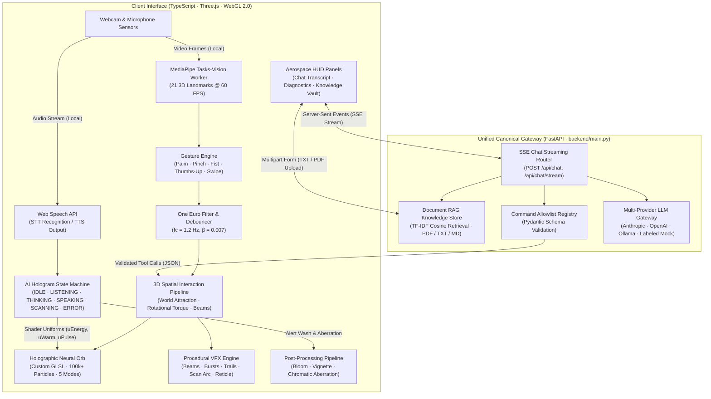

# ULTIMAITRON AI 2.0 — Holographic AI Companion Interface

<p align="center">
  
  
  
  
  
  
  
  
  
</p>

<p align="center">
  <strong>A high-performance gesture-controlled holographic artificial intelligence companion core powered by Three.js/GLSL, MediaPipe computer vision, Web Speech STT/TTS, and a unified FastAPI Server-Sent Events (SSE) streaming gateway with multi-provider LLM support and RAG document grounding.</strong>
</p>

---

## 📑 Table of Contents

1. [System Overview & Architecture](#1-system-overview--architecture)
2. [3D Graphics, Animations & Visual Effects](#2-3d-graphics-animations--visual-effects)
3. [Mathematical Foundations & Shader Formulations](#3-mathematical-foundations--shader-formulations)
4. [Computer Vision & Gesture Control](#4-computer-vision--gesture-control)
5. [AI Companion Brain & Streaming Backend](#5-ai-companion-brain--streaming-backend)
6. [Central Command Registry & Tool Calling](#6-central-command-registry--tool-calling)
7. [Voice Interaction & Phonetic Waveforms](#7-voice-interaction--phonetic-waveforms)
8. [Document Knowledge Vault (RAG)](#8-document-knowledge-vault-rag)
9. [Aerospace HUD & Diagnostics Telemetry](#9-aerospace-hud--diagnostics-telemetry)
10. [Repository Directory Structure](#10-repository-directory-structure)
11. [Quick Start & Local Setup](#11-quick-start--local-setup)
12. [Docker Deployment](#12-docker-deployment)
13. [Verification & Test Suites](#13-verification--test-suites)
14. [Keyboard & Gesture Reference](#14-keyboard--gesture-reference)
15. [Security & Production Hardening](#15-security--production-hardening)
16. [Limitations & Design Trade-offs](#16-limitations--design-trade-offs)
17. [License](#17-license)

---

## 1. System Overview & Architecture

ULTIMAITRON AI 2.0 unites real-time 3D spatial computing, local edge computer vision, and high-performance server-side LLM inference into a unified aerospace holographic interface. 

The application runs an unthrottled WebGL rendering loop decoupled from network I/O, ensuring that token streaming, audio processing, and document retrieval never induce framerate stalls or render hitches.



---

## 2. 3D Graphics, Animations & Visual Effects

The core rendering engine is constructed with **Three.js (r185)** and custom **GLSL vertex and fragment shaders**, completely avoiding high-level abstractions to ensure zero per-frame garbage collection allocations ($0\text{ bytes/frame}$).

### 2.1 The Neural Orb Subsystems

The central hologram consists of five coordinated procedural layers:

1. **`ParticleSystem` (Neural Lattice)**:
   - Up to **120,000+ points** positioned via recursive icosahedral geodesic tessellation.
   - Deformed along surface normal vectors by dual-octave 3D Simplex noise.
   - Vertices store custom attributes: base positions, cluster IDs, phase offsets, and connectivity indices.

2. **`NeuralNetwork` (Dynamic Synapses)**:
   - Up to **10,000 active line segments** rendered as non-indexed geometry.
   - Dynamically calculates euclidean distance thresholds between adjacent particle clusters.
   - Modulated by spherical energy pulse wavefronts propagating outward from coordinate $(0,0,0)$.

3. **`EnergyCore` (Inner Fusion Core)**:
   - High-density inner sphere with additive blending.
   - Renders volumetric Rayleigh scattering glow and rapid inner plasma oscillations.

4. **`OrbitalRings` (Gyro Gimbal)**:
   - Nested concentric holographic rings orbiting at golden-ratio angular velocity ratios ($\phi \approx 1.618$).
   - Features micro-tick calibration marks and azimuth orientation indicators.

5. **`DataMotes` (Ambient Energy Field)**:
   - Floating stochastic energy motes exhibiting Brownian drift within a spherical bounding hull ($r = 1.8 R_0$).

```
                      ┌─────────────────────────────────────────┐
                      │          NEURAL ORB ARCHITECTURE         │
                      └─────────────────────────────────────────┘
                                           │
         ┌──────────────────┬──────────────┴─────┬──────────────────┐
         ▼                  ▼                    ▼                  ▼
┌──────────────────┐ ┌───────────────┐ ┌───────────────────┐ ┌───────────────┐
│ Particle Lattice │ │ Synapse Lines │ │ Energy Core (PPM) │ │ Orbital Rings │
│ (120k Points)    │ │ (10k Synapses)│ │ (Fusion Glow)     │ │ (Gimbal φ vel)│
└──────────────────┘ └───────────────┘ └───────────────────┘ └───────────────┘
```

### 2.2 Procedural Modes

The hologram transitions seamlessly between five operational modes via uniform weight interpolation ($\tau_{\text{blend}} = 0.42\text{s}$):

| Mode | Shader Visual Behavior | Energy Baseline | Warmth | Spin Multiplier |
|---|---|---|---|---|
| **`NEURAL`** | High synapse connectivity, biological pulsing, cyan spectrum ($\lambda \approx 490\text{nm}$). | $0.35$ | $0.00$ | $1.0\times$ |
| **`REACTOR`** | High-velocity rotational spin, compressed radius, golden fusion plasma. | $0.85$ | $0.85$ | $3.2\times$ |
| **`DATA`** | Synapses dissolve into a structured point cloud matrix with periodic quantum motes. | $0.20$ | $0.15$ | $0.4\times$ |
| **`ENERGY`** | Violent radial turbulence, expanded outer corona, high-frequency motes. | $0.95$ | $0.45$ | $2.0\times$ |
| **`SCANNER`** | Concentrated radar arc plane sweeping $360^\circ$ with coordinate reticle locks. | $0.70$ | $0.10$ | $0.8\times$ |

### 2.3 Real-time Visual Effects (VFX)

- **`HolographicBeam`**: Volumetric dual-pass light funnels connecting active fingertip coordinates in 3D camera space directly to the orb center.
- **`HandTrail`**: Ribbon-style particle emitter that trails fast hand gestures, featuring exponential alpha decay and velocity-aligned stretching.
- **`ParticleBurst`**: Omnidirectional explosion of 320 high-velocity spark fragments triggered by fist release or AI command.
- **`ScanArc`**: Truncated wedge mesh sweeping angular azimuths with trailing exponential phosphorescence decay.
- **`OrbitalNodes`**: Interactive 3D celestial nodes circling the orb; support raycasted hover states and pinch-selection.
- **`HandSkeleton`**: 3D cybernetic bones connecting all 21 MediaPipe hand landmarks in real-time camera space.
- **`Reticle`**: Sci-fi targeting rings that track hand centroid coordinates with smooth lerp damping.

---

## 3. Mathematical Foundations & Shader Formulations

### 3.1 Geodesic Icosahedral Tessellation
To eliminate pole-pinching artifacts inherent to UV spheres, vertices are constructed by recursively subdividing an icosahedron and normalizing to a unit sphere $S^2$:
$$v_{\text{mid}} = \frac{v_1 + v_2}{\|v_1 + v_2\|_2} \cdot R_0$$
This yields isotropic particle distribution where each vertex maintains an almost identical surface area element $dA$.

### 3.2 Dual-Octave Simplex Noise Normal Displacement
In the custom vertex shader (`orb.vert.glsl`), particle vertices are displaced along their outward surface normals $\vec{n} = \frac{v}{\|v\|}$:
$$P'(v, t) = v + \vec{n} \cdot \left[ A_1 \cdot \mathcal{N}\left(v \cdot f_1 + \vec{\omega}_1 t\right) + A_2 \cdot \mathcal{N}\left(v \cdot f_2 - 1.6 \vec{\omega}_1 t\right) \right] \cdot \Phi_{\text{energy}} \cdot \Psi_{\text{voice}}$$
where:
- $\mathcal{N}(x)$ is a 3D simplex noise function implemented in GLSL.
- $\Phi_{\text{energy}} \in [0, 1]$ represents the state-driven energy uniform (`uEnergy`).
- $\Psi_{\text{voice}} \in [1.0, 1.35]$ represents the speech amplitude multiplier.

### 3.3 Spherical Pulse Wavefront Propagation
Shockwaves initiated by user gestures or tool calls propagate across the surface via an expanding spherical wavefront shell:
$$\Delta r(v, t) = \|v - \vec{p}_{\text{origin}}\|_2 - c \cdot (t - t_{\text{start}})$$
The pulse contribution to vertex intensity is evaluated as a Gaussian envelope:
$$I_{\text{pulse}}(v) = \exp\left(-\frac{\Delta r(v, t)^2}{2 \sigma_{\text{width}}^2}\right) \cdot \exp\left(-\gamma \cdot (t - t_{\text{start}})\right)$$
where $c$ is the wavefront velocity ($4.4\text{ units/s}$) and $\gamma$ is temporal decay.

### 3.4 Multi-Harmonic Phonetic Voice Amplitude
To drive authentic holographic rippling during speech without requiring cross-origin audio loopback nodes, voice output generates an analytical multi-harmonic phonetic envelope:
$$A(t) = 0.5 + 0.3 \sin(0.7 \omega t) + 0.15 \sin(2.1 \omega t) + 0.1 \sin(4.3 \omega t)$$
clamped to $A(t) \in [0.15, 1.0]$. The resulting envelope directly modulates `uEnergy` and `uBreath` uniforms in real time.

---

## 4. Computer Vision & Gesture Control

Optical gesture input is powered by **Google MediaPipe Tasks-Vision** executing in an isolated Web Worker, preventing camera inference from interrupting the Three.js 60 FPS rendering pipeline.

```
 Camera Stream (60fps) ──► OffscreenCanvas ──► Web Worker (MediaPipe Tasks-Vision)
                                                       │
                                              21 3D Landmarks
                                                       ▼
 Pointer Fallback (Mouse/Touch) ◄── [Failover] ── One Euro Filter (fc=1.2Hz, β=0.007)
                                                       │
                                           Gesture State Machine
                                                       ▼
                              [OPEN_PALM · PINCH · FIST · THUMBS_UP · SWIPE]
```

### 4.1 Supported Gestures & Action Mapping

| Gesture | Biomechanical Trigger | Latency & Debounce | Interface / 3D Action |
|---|---|---|---|
| **`OPEN_PALM`** | All fingers extended ($d > 0.12$), palm facing camera. | $120\text{ms}$ debounce | Energizes core, triggers concentric pulses. |
| **`PINCH`** | Distance between thumb tip and index tip $< 0.045$. | Instant edge trigger | Target acquisition, 3D spatial rotation, node selection. |
| **`FIST`** | All fingertips contracted inside palm bounding radius. | Instant edge trigger | Compresses orb scale; releases explosive power surge on release. |
| **`THUMBS_UP`** | Thumb vertical ($\Delta y > 0.08$), all fingers curled into palm. | $150\text{ms}$ debounce | Affirms choices, confirms pending actions. |
| **`SWIPE`** | Rapid lateral hand translation ($\|v_x\| > 1.2\text{ units/s}$). | $350\text{ms}$ cooldown | Cycles forward/backward through procedural modes. |

### 4.2 One Euro Temporal Filtering
To eliminate optical hand tremor while preserving zero-lag response during rapid motions, coordinates pass through adaptive One Euro filters:
$$f_c = f_{c,\min} + \beta \cdot \|\dot{x}\|$$
$$\alpha = \frac{1}{1 + \frac{1}{2 \pi f_c \Delta t}}$$
$$x_{\text{filtered}} = \alpha \cdot x + (1 - \alpha) \cdot x_{\text{prev}}$$
with $f_{c,\min} = 1.2\text{ Hz}$ and $\beta = 0.007$.

### 4.3 Clean Hardware Lifecycle
Camera streams and audio tracks enforce strict user-initiated activation and full hardware resource release. Disabling camera or mic calls `.stop()` on every underlying `MediaStreamTrack`, immediately turning off hardware activity LEDs.

---

## 5. AI Companion Brain & Streaming Backend

The backend is organized around a unified, canonical FastAPI gateway (`backend/main.py`), providing production-grade Server-Sent Events (SSE) streaming, asynchronous concurrency, strict Pydantic data validation, and an allowlisted command execution engine.

### 5.1 Multi-Provider Gateway

The backend dynamically selects between four LLM execution modes configured via `.env`:

1. **Anthropic Claude**: Connects via official Anthropic REST streaming API (`claude-3-5-sonnet-20241022`).
2. **OpenAI**: Connects to OpenAI v1 completions streaming API (`gpt-4o-mini`, `gpt-4o`).
3. **Ollama (Local LLM)**: Connects to local Ollama daemon (`llama3.2`, `mistral`) for 100% offline edge inference.
4. **Intelligent Offline Mock Assistant**: Zero-setup, standalone companion that answers technical queries, inspects system telemetry, and triggers valid tool calls without an API key or internet access. Explicitly labeled `[OFFLINE SIMULATION · MOCK AI CORE]`.

### 5.2 Server-Sent Events (SSE) Protocol

Streaming tokens and actions are dispatched through `POST /api/chat` and `POST /api/chat/stream`:
- `data: {"type": "token", "data": "Hello"}` or `data: {"token": "Hello"}` — Emitted as individual tokens stream in.
- `data: {"type": "tool_call", "data": {"id": "call_1", "name": "change_orb_mode", "arguments": {"mode": "REACTOR"}}}` — Dispatched when the LLM invokes an interface action.
- `event: sources` / `data: {"type": "citation", "data": [...]}` — Dispatched with document names, page numbers, and relevance scores.
- `event: done` / `data: {"type": "done", "data": true}` — Terminal frame concluding the stream.

---

## 6. Central Command Registry & Tool Calling

To ensure security and prevent arbitrary code execution, the LLM is restricted to a strictly bounded **Central Command Registry**. Every tool call generated by the model must match an allowlisted JSON Schema:

```
LLM Output ──► JSON Schema Validator ──► Allowlist Check ──► CommandExecutor ──► 3D Scene
                      │ (Invalid)
                      └──► Rejected (No Action Taken)
```

### Registered Tools

```json
[
  {
    "name": "change_orb_mode",
    "description": "Morphs the 3D hologram into one of the procedural configurations",
    "parameters": {
      "type": "object",
      "properties": {
        "mode": { "type": "string", "enum": ["NEURAL", "REACTOR", "DATA", "ENERGY", "SCANNER"] }
      },
      "required": ["mode"]
    }
  },
  {
    "name": "fire_pulse",
    "description": "Dispatches a high-energy spherical wavefront through the holographic lattice",
    "parameters": {
      "type": "object",
      "properties": {
        "intensity": { "type": "number", "minimum": 0.1, "maximum": 3.0 }
      }
    }
  },
  {
    "name": "trigger_burst",
    "description": "Ejects a high-velocity particle shockwave from the core",
    "parameters": {
      "type": "object",
      "properties": {
        "warm": { "type": "number", "minimum": 0.0, "maximum": 1.0 }
      }
    }
  },
  {
    "name": "set_orb_scale",
    "description": "Scales the physical footprint of the 3D hologram",
    "parameters": {
      "type": "object",
      "properties": {
        "scale": { "type": "number", "minimum": 0.62, "maximum": 1.85 }
      },
      "required": ["scale"]
    }
  },
  {
    "name": "set_warmth",
    "description": "Shifts holographic spectrum from cold cyan (0.0) to warm golden amber (1.0)",
    "parameters": {
      "type": "object",
      "properties": {
        "warmth": { "type": "number", "minimum": 0.0, "maximum": 1.0 }
      },
      "required": ["warmth"]
    }
  },
  {
    "name": "open_panel",
    "description": "Opens or toggles aerospace HUD panels",
    "parameters": {
      "type": "object",
      "properties": {
        "panel": { "type": "string", "enum": ["chat", "diagnostics", "knowledge"] }
      },
      "required": ["panel"]
    }
  },
  {
    "name": "reset_system",
    "description": "Resets hologram scale, orientation, camera rig, and restores NEURAL mode"
  }
]
```

---

## 7. Voice Interaction & Phonetic Waveforms

- **Hands-Free Web Speech STT**: Continuous or push-to-talk speech recognition with live interim feedback displayed directly inside the chat bar.
- **Natural Web Speech TTS**: Reads AI responses aloud with automatic markdown stripping and voice selection (prefers Samantha, Daniel, or Google Natural voices).
- **Phonetic Cadence Simulation**: Computes multi-harmonic envelopes to dynamically ripple the 3D hologram surface during speech playback.
- **Privacy First**: Audio is processed entirely through browser APIs; no microphone audio bytes are ever sent to the backend server.

---

## 8. Document Knowledge Vault (RAG)

The Document Knowledge Vault allows users to ground AI conversations in local reference documents:

- **Supported Formats**: `.txt`, `.pdf`, `.md`, `.json` up to **10 MB**.
- **Security & DoS Protection**: 
  - Maximum **1,000 PDF pages** per document.
  - Maximum **1,000,000 characters** text extraction cap.
  - Strict PDF magic signature validation (`%PDF-`) and corrupted PDF rejection.
  - Path traversal defense with regex sanitization on filenames.
- **Text Extraction & Citations**: Uses `pypdf` with page tracking to provide accurate page citations (`[Source: manual.pdf (p. 3)]`).
- **TF-IDF Cosine Retrieval**: Evaluates query vectors against document chunk term-frequency matrices without external vector database dependencies:
  $$\text{sim}(Q, D_i) = \frac{\vec{q} \cdot \vec{d}_i}{\|\vec{q}\|_2 \|\vec{d}_i\|_2}$$
- **Insufficient Evidence Indication**: If document similarity falls below confidence thresholds, the system explicitly reports that the knowledge vault lacks relevant evidence rather than hallucinating.

---

## 9. Aerospace HUD & Diagnostics Telemetry

The user interface follows a strict aerospace instrumentation aesthetic: thin rules, monospace telemetry fonts, and cyan/ice illumination.

### Panels
1. **AI Neural Transcript (`T`)**: Streaming conversation history, tool action pills, citation tags, voice mic toggle, and clear controls.
2. **Diagnostics Telemetry (`X`)**: Real-time performance readouts.
3. **Document Knowledge Vault (`K`)**: Drag-and-drop file upload zone, indexed document lists, chunk counts, and vault purge controls.

### Verified Runtime Metrics (No Fabricated Telemetry)
- **Render FPS & Frame Time**: Real measured WebGL animation frame interval ($\text{ms}$).
- **Optical Gesture Latency**: Execution time of MediaPipe inference worker ($\text{ms}$).
- **Inference Rate**: Frequency of landmark processing ($\text{Hz}$).
- **AI Time to First Token (TTFT)**: Elapsed time from prompt submission to first streamed SSE byte ($\text{ms}$).
- **Total AI Duration**: End-to-end response completion time ($\text{ms}$).
- **Active Particles & GPU Draw Calls**: Hardware counters read from `renderer.info`.

---

## 10. Repository Directory Structure

```
ULTIMAITRON-UI-main/
├── .github/
│   └── workflows/
│       └── ci.yml             # GitHub Actions CI (Typecheck, Build, Pytest)
├── backend/
│   ├── routers/
│   │   ├── chat.py            # SSE chat streaming router (/api/chat, /api/chat/stream)
│   │   ├── documents.py       # RAG upload, retrieval, and purge router
│   │   └── system.py          # Health check, readiness & commands router
│   ├── services/
│   │   ├── command_registry.py# Safe allowlisted tool registry
│   │   ├── llm_service.py     # Claude / OpenAI / Ollama / Labeled Mock adapters
│   │   └── rag_service.py     # Chunking & TF-IDF cosine retrieval
│   ├── config.py              # Pydantic-settings configuration with env_file support
│   ├── Dockerfile             # Python FastAPI container build
│   ├── main.py                # Single canonical FastAPI application gateway
│   ├── requirements.txt       # Python dependencies
│   └── schemas.py             # Dual-schema compatible Pydantic models
├── deploy/
│   └── nginx.conf             # Production reverse proxy (SSE unbuffered)
├── src/
│   ├── ai/                    # Frontend AI Companion Layer
│   │   ├── AIClient.ts        # SSE reader with TTFT & latency tracking
│   │   ├── AIStateManager.ts  # Holographic state machine & profiles
│   │   ├── CommandExecutor.ts # Safe dispatcher for tool calls
│   │   ├── VoiceAssistant.ts  # Web Speech STT/TTS & phonetic amplitude
│   │   └── types.ts           # Shared AI types & event interfaces
│   ├── audio/                 # Procedural Web Audio synthesizer
│   ├── effects/               # Procedural 3D Visual Effects
│   │   ├── HandSkeleton.ts    # 3D Cybernetic bone visualization
│   │   ├── HandTrail.ts       # Velocity-aligned particle ribbons
│   │   ├── HolographicBeam.ts # Volumetric fingertip tractor beams
│   │   ├── OrbitalNodes.ts    # Interactive celestial data nodes
│   │   ├── ParticleBurst.ts   # Omnidirectional shockwave explosion
│   │   ├── Reticle.ts         # Holographic targeting reticle
│   │   └── ScanArc.ts         # Directional sweeping radar arc
│   ├── interaction/           # Input smoothing, mapping & gestures
│   ├── orb/                   # Neural Orb geometry & shader management
│   ├── scene/                 # Camera rig, renderer factory & post-processing
│   ├── shaders/               # Custom GLSL vertex & fragment shaders
│   ├── ui/                    # Aerospace HUD & telemetry panels
│   │   ├── ChatPanel.ts       # Streaming AI transcript interface
│   │   ├── DiagnosticsPanel.ts# Real-time telemetry dashboard
│   │   ├── KnowledgePanel.ts  # Document upload & chunk management
│   │   └── styles.css         # Aerospace HUD stylesheet
│   ├── vision/                # MediaPipe Tasks-Vision hand tracker
│   ├── config.ts              # Central configuration & tunable constants
│   └── main.ts                # Application lifecycle bootstrap
├── tests/
│   └── test_backend.py        # Comprehensive backend test suite (15 tests)
├── docker-compose.yml         # Containerized multi-service deployment
├── Dockerfile                 # Frontend multi-stage Nginx build
├── package.json               # Node.js dependencies & scripts
├── pytest.ini                 # Pytest configuration
├── tsconfig.json              # Strict TypeScript configuration
└── vite.config.ts             # Vite development & proxy configuration
```

---

## 11. Quick Start & Local Setup

### 11.1 Prerequisites
- **Node.js**: v20.0 or higher
- **Python**: v3.12 or v3.14
- **Web Browser**: Modern browser with WebGL hardware acceleration enabled

### 11.2 Installation

```bash
# 1. Clone repository
git clone https://github.com/sathvikkasanagpttu/ultimaitron-ai.git
cd ultimaitron-ai

# 2. Setup Node.js frontend dependencies
npm ci

# 3. Setup Python virtual environment & backend dependencies
python3 -m venv .venv
source .venv/bin/activate
pip install -r backend/requirements.txt

# 4. Configure environment variables
cp .env.example .env
```

### 11.3 Running the Application

Open two terminal sessions:

**Terminal 1 — FastAPI Backend**:
```bash
source .venv/bin/activate
uvicorn backend.main:app --host 127.0.0.1 --port 8000 --reload
```

**Terminal 2 — Vite Frontend**:
```bash
npm run dev
```

Open your browser at **`http://localhost:5173`**. The Vite development server automatically proxies `/api` calls to `http://127.0.0.1:8000`.

---

## 12. Docker Deployment

Deploy the entire stack with a single command using Docker Compose:

```bash
docker compose up --build
```

- **Frontend**: Nginx serves the optimized production bundle at **`http://localhost:8080`**.
- **Backend**: FastAPI runs with Uvicorn on port `8000` (proxied internally through Nginx under `/api/`).
- **SSE Buffering**: `deploy/nginx.conf` is configured with `proxy_buffering off` to guarantee zero-latency token streaming.

---

## 13. Verification & Test Suites

The project maintains strict continuous verification across TypeScript and Python:

```bash
# 1. TypeScript Strict Typecheck (0 errors)
npm run typecheck

# 2. Production Vite Build
npm run build

# 3. Comprehensive Pytest Suite (All 15 tests passing)
.venv/bin/pytest -v
```

---

## 14. Keyboard & Gesture Reference

### Keyboard Shortcuts

| Key | Action | Description |
|---|---|---|
| `1` – `5` | Switch Orb Mode | `1: NEURAL`, `2: REACTOR`, `3: DATA`, `4: ENERGY`, `5: SCANNER` |
| `T` | Toggle AI Chat | Opens/minimizes the AI transcript panel |
| `V` | Toggle Voice | Starts or stops hands-free speech recognition (STT) |
| `X` | Toggle Diagnostics | Shows/hides the real-time telemetry dashboard |
| `K` | Knowledge Vault | Opens/closes document upload & management |
| `G` | Toggle Camera | Starts or stops the optical MediaPipe hand tracker |
| `Space` | Energy Pulse | Fires an omnidirectional power surge wavefront |
| `R` | Reset System | Re-centers camera distance and restores NEURAL configuration |
| `H` | Toggle HUD | Hides/reveals all overlay interface elements |
| `D` | Debug Mode | Shows/hides 3D skeletal landmark overlays and video feed |
| `Esc` | Close Modals | Closes open panels and dismisses active notifications |

### Optical Hand Gestures

| Gesture Icon | Gesture | System Effect |
|---|---|---|
| 🖐️ | **Open Palm** | Accelerates particle spin and fires concentric ripple waves |
| 🤏 | **Pinch & Drag** | Acquires target coordinates; rotates the orb in 3D space |
| ✊ | **Fist Hold & Release**| Compresses lattice radius; detonates an omnidirectional particle burst on release |
| 👍 | **Thumbs Up** | Confirms choices; triggers affirmative companion sound and pulse |
| 👋 | **Lateral Swipe** | Morphs sequentially between the 5 procedural modes |

---

## 15. Security & Production Hardening

- **CORS Hardening**: Explicit origin whitelist sourced from environment (`FRONTEND_ORIGINS`), preventing wildcard origins from combining with credentialed sessions.
- **Security Headers**: Standard injection of `X-Content-Type-Options: nosniff`, `X-Frame-Options: DENY`, and `Referrer-Policy: strict-origin-when-cross-origin`.
- **Rate Limiting**: Sliding window rate-limiting middleware on all `/api/chat` and `/api/documents` endpoints (60 req/min default).
- **Tool Call Allowlist**: Strict Pydantic parameter validation prevents arbitrary or unapproved command execution.
- **Transparent LLM Mocking**: Responses in mock mode are explicitly tagged with `[OFFLINE SIMULATION · MOCK AI CORE]`.

---

## 16. Limitations & Design Trade-offs

1. **Local Audio Loopback**: Browsers restrict programmatic audio capturing of `SpeechSynthesisUtterance` into Web Audio `AnalyserNode` instances without insecure permissions. ULTIMAITRON AI 2.0 solves this cleanly by synthesizing a multi-harmonic phonetic envelope ($A(t)$) that drives identical visual ripples across all browsers.
2. **Scanned PDF OCR**: Document knowledge retrieval supports digital text-based PDF, TXT, MD, and JSON files. Scanned image-only PDFs require an external OCR pre-processing step.
3. **In-Memory Rate Limiter**: The built-in rate limiter operates in process memory for lightweight single-node deployments. High-availability multi-node deployments should connect to a Redis-backed token bucket.

---

## 17. License

This project is licensed under the **MIT License**.  
Crafted for creative technology experimentation, real-time computer vision research, and next-generation human-AI interaction.
